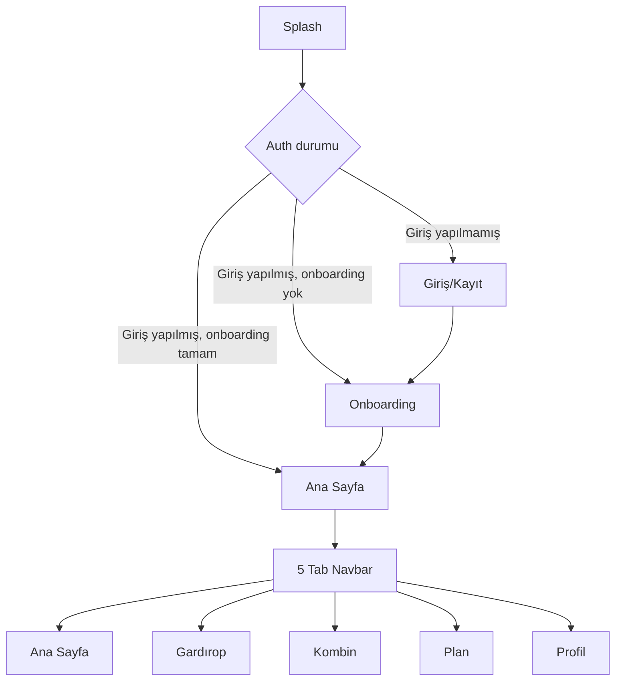
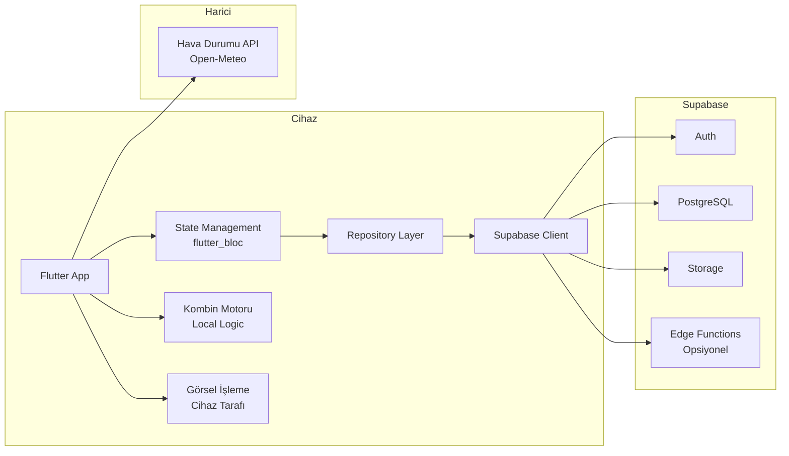
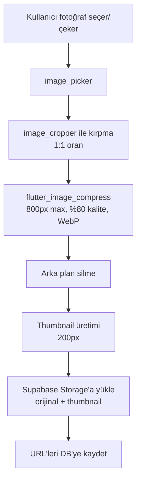
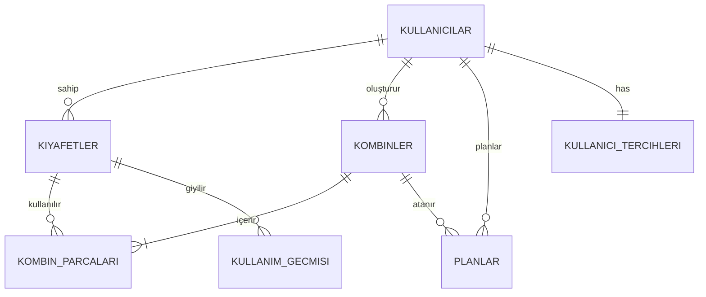

# CombinApp — Dijital Gardırop & Kombin Planlama Uygulaması

---

## 1. Ürün Özeti

**Problem:** Kullanıcılar her sabah "ne giyeceğim?" sorusuyla karşı karşıya kalıyor. Bu karar yorgunluğu, özellikle hava durumu ve gün içi etkinlik değişkenlerini de düşününce zaman kaybına dönüşüyor.

**Çözüm:** Kullanıcının dolabını dijital ortama taşıyan, hava durumu ve etkinlik tipine göre mevcut parçalardan kombin öneren, haftalık plan yapılmasına izin veren bir Flutter mobil uygulaması.

**Hedef platform:** iOS ve Android (Flutter ile tek codebase)
**Backend:** Supabase (free plan)
**Tasarım dili:** Apple Liquid Glass estetiği — kırık beyaz arka plan, cam kartlar, yumuşak gölgeler, `#C84153` vurgu rengi

---

## 2. MVP Kapsamı

| Modül | Kapsam |
|-------|--------|
| Kimlik doğrulama | E-posta/şifre kayıt, giriş, şifre sıfırlama |
| Onboarding | Şehir seçimi, stil tipi, kullanım amacı, hava durumu izni |
| Gardırop | Kıyafet CRUD, fotoğraf yükleme, arka plan silme, etiketleme (kategori/renk/mevsim/kalınlık), filtreleme, arama, favori |
| Kombin | "Bugün ne giyeyim?" akışı, etkinlik seçimi, hava durumuna göre öneri, kaydetme, listeleme, favori, parça değiştirme |
| Planlama | Haftalık takvim, güne kombin atama, değiştir/kaldır |
| Ana Sayfa | Karşılama, hava durumu özeti, bugünün kombini, hızlı işlemler, son eklenenler, favori kombinler |
| Profil | Kullanıcı bilgileri, tercihler, bildirim ayarları, çıkış |
| Kullanım geçmişi | Hangi parça ne zaman giyildi — basit log |
| Boş/hata durumları | Tüm ekranlar için empty state ve error state |

---

## 3. Sonraki Faza Bırakılacaklar

| Özellik | Gerekçe |
|---------|---------|
| Sosyal paylaşım akışı | Scope büyütür, MVP odağını bozar |
| Keşfet / topluluk modülü | Kullanıcı tabanı olmadan anlamsız |
| Yorum, takip, mesajlaşma | Sosyal katman MVP'de yok |
| AI tabanlı stil önerisi | Maliyet yüksek, önce rule-based motor yeterli |
| Marka/mağaza entegrasyonu | İş geliştirme gerektirir |
| Çoklu dil desteği | İlk sürüm Türkçe, sonra genişler |
| Push notification (hatırlatma) | İlk sürümde basit tutulacak, planlı bildirimler sonraki faz |
| Fotoğraftan otomatik kategori tanıma | ML model gerektirir, manuel etiketleme yeterli |

---

## 4. Kullanıcı Akışları

### 4.1 İlk Açılış Akışı
```
Splash → Kayıt/Giriş → Onboarding (şehir → stil → amaç → hava izni) → Ana Sayfa
```

### 4.2 Kıyafet Ekleme Akışı
```
Gardırop → (+) Ekle → Fotoğraf çek/seç → Arka plan sil → Etiketleme (kategori, renk, mevsim, kalınlık) → Kaydet → Gardırop listesine dön
```

### 4.3 Kombin Önerisi Akışı
```
Ana Sayfa / Kombin → "Bugün ne giyeyim?" → Etkinlik seç (ofis/günlük/spor) → Hava durumu çekilir → Kombin önerisi gösterilir → Beğendiyse Kaydet / Beğenmediyse Yenile / Parça değiştir
```

### 4.4 Planlama Akışı
```
Plan → Haftalık takvim → Gün seç → Kombin ata (kayıtlı kombinlerden veya yeni öneri) → Kaydedildi
```

### 4.5 Sabah Kullanımı (Ana Senaryo)
```
Uygulama aç → Ana Sayfa → Bugünün kombini kartı → Detay gör / Değiştir → Kabul et → Güne başla
```

---

## 5. Ekran Listesi

| # | Ekran | Erişim |
|---|-------|--------|
| 1 | Splash | Otomatik |
| 2 | Giriş | Auth |
| 3 | Kayıt | Auth |
| 4 | Şifre Sıfırlama | Auth |
| 5 | Onboarding — Şehir | İlk açılış |
| 6 | Onboarding — Stil Tipi | İlk açılış |
| 7 | Onboarding — Kullanım Amacı | İlk açılış |
| 8 | Onboarding — Hava İzni | İlk açılış |
| 9 | Ana Sayfa | Navbar |
| 10 | Gardırop — Liste | Navbar |
| 11 | Gardırop — Kıyafet Detay | Gardırop'tan |
| 12 | Gardırop — Kıyafet Ekle/Düzenle | Gardırop'tan |
| 13 | Kombin — Ana | Navbar |
| 14 | Kombin — Etkinlik Seçimi | Kombin akışı |
| 15 | Kombin — Öneri Sonuç | Kombin akışı |
| 16 | Kombin — Detay | Kombin listesinden |
| 17 | Kombin — Kayıtlı Kombinler | Kombin ana |
| 18 | Plan — Haftalık Takvim | Navbar |
| 19 | Plan — Gün Detay | Takvimden |
| 20 | Profil | Navbar |
| 21 | Profil — Tercihleri Düzenle | Profilden |
| 22 | Kullanım Geçmişi | Profilden |

---

## 6. Ekran Bazlı İçerik ve Aksiyonlar

### 6.1 Splash Ekranı
- Uygulama logosu + kısa animasyon
- Auth durumu kontrol → yönlendirme

### 6.2 Giriş Ekranı
- E-posta input
- Şifre input
- "Giriş Yap" butonu (`#C84153`)
- "Kayıt Ol" link
- "Şifremi Unuttum" link

### 6.3 Kayıt Ekranı
- İsim, e-posta, şifre inputları
- "Kayıt Ol" butonu (`#C84153`)
- "Zaten hesabım var" link

### 6.4 Onboarding Ekranları (4 adım, step indicator)
- **Şehir:** Arama ile şehir seçimi (Türkiye illeri)
- **Stil:** Tekli seçim (minimal, klasik, sportif, bohemian, karışık)
- **Amaç:** Çoklu seçim (iş/ofis, günlük, özel davet, spor)
- **Hava İzni:** Konum izni alma + açıklama metni

### 6.5 Ana Sayfa
| Alan | İçerik |
|------|--------|
| Karşılama | "Günaydın, {isim}" + tarih |
| Hava Durumu | Şehir, sıcaklık, durum ikonu |
| Bugünün Kombini | Planlı kombin kartı veya "Hızlı Kombin Al" butonu |
| Hızlı İşlemler | Kıyafet Ekle, Kombin Oluştur (2 kart) |
| Son Eklenenler | Yatay kaydırılır kıyafet kartları (son 5) |
| Favori Kombinler | Yatay kaydırılır kombin kartları (son 3) |

### 6.6 Gardırop Ekranı
- Üstte grid/liste geçiş toggle
- Arama çubuğu
- Filtre bar: kategori, renk, mevsim (chip şeklinde)
- Kıyafet kartları: fotoğraf + alt başlık (kategori)
- Sağ alt: Floating "+" butonu (`#C84153`)
- Empty state: "Dolabın boş! İlk kıyafetini ekle."

### 6.7 Kıyafet Detay
- Tam boy fotoğraf (arka planı silinmiş)
- Etiketler: kategori, renk, mevsim, kalınlık
- Favori toggle (kalp ikonu, seçili: `#C84153`)
- "Bu parçayla kombin yap" butonu
- Düzenle / Sil aksiyonları
- Kullanım geçmişi: son 5 kullanım tarihi

### 6.8 Kıyafet Ekle/Düzenle
- Fotoğraf alanı: kameradan çek / galeriden seç
- Arka plan silme (işlem göstergesi ile)
- Kategori seçimi: üst giyim, alt giyim, dış giyim, ayakkabı, aksesuar, çanta
- Renk seçimi: renk paletinden seçim
- Mevsim: ilkbahar, yaz, sonbahar, kış, tüm mevsim (çoklu seçim)
- Kalınlık: ince, orta, kalın
- "Kaydet" butonu (`#C84153`)

### 6.9 Kombin Ana Ekranı
- "Bugün Ne Giyeyim?" büyük kart (`#C84153` gradient aksan)
- Kayıtlı Kombinler bölümü (grid)
- Favori Kombinler bölümü (yatay scroll)

### 6.10 Etkinlik Seçimi
- Bottom sheet veya tam sayfa
- 3 seçenek kartı: Ofis, Günlük, Spor
- Her kart: ikon + başlık
- Seçince kombin motorunu tetikler

### 6.11 Kombin Öneri Sonuç
- Önerilen parçalar dikey sıralı: üst + alt + ayakkabı + (varsa) dış giyim + (varsa) aksesuar
- Her parça kartta:
  - Kıyafet fotoğrafı
  - Kategori etiketi
  - Değiştir ikonu (tap → aynı kategoride alternatif)
- Alt aksiyonlar: "Kaydet", "Favorilere Ekle", "Takvime Ekle", "Yeni Öneri"

### 6.12 Kombin Detay
- Kombin içindeki tüm parçaların fotoğrafları
- Oluşturulma tarihi
- Etkinlik tipi etiketi
- Kaç kez giyildi
- Aksiyonlar: Favorile, Takvime Ekle, Sil

### 6.13 Plan — Haftalık Takvim
- Yatay hafta seçici (mevcut hafta varsayılan)
- 7 günlük dikey liste
- Her gün kartı: tarih + küçük kombin önizleme veya "Kombin Ekle" butonu
- Bugün vurgulu (`#C84153` sol border)

### 6.14 Plan — Gün Detay
- Seçili günün tarihi ve hava durumu tahmini
- Atanmış kombin kartı (büyük)
- Aksiyonlar: Değiştir, Kaldır
- Kombin atanmamışsa: "Kombin Ata" butonu → kayıtlı kombinler listesi veya yeni öneri

### 6.15 Profil
- Avatar (isim baş harfleri ile placeholder)
- İsim, e-posta (read-only)
- Şehir, stil tipi, kullanım amacı (düzenlenebilir)
- "Kullanım Geçmişi" linki
- Bildirim ayarları toggle
- Veri / gizlilik ayarları
- "Çıkış Yap" butonu
- Uygulama versiyonu

---

## 7. Alt Navbar ve Navigasyon Yapısı

```
┌─────────────────────────────────────────────────┐
│  🏠 Ana Sayfa  │  👗 Gardırop  │  ✨ Kombin  │  📅 Plan  │  👤 Profil  │
└─────────────────────────────────────────────────┘
```

- **Navigasyon tipi:** `BottomNavigationBar` veya `NavigationBar` (Material 3)
- **Seçili ikon rengi:** `#C84153`
- **Seçili olmayan:** `#999999`
- **Arka plan:** Buzlu cam efektli beyaz/şeffaf
- **Her tab'ın kendi navigator stack'i:** `IndexedStack` + `Navigator` ile tab bazlı navigation state korunur
- **Geçiş animasyonu:** Fade (performans için)

**Navigasyon akışı:**


---

## 8. Kombin Öneri Motoru — Mantıksal Akış

Rule-based bir motor. Başlangıçta ML/AI yok. Basit, deterministik, genişletilebilir.

### 8.1 Girdi
```
- havaDurumu: { sicaklik: int, durum: string }  // ör: 15°C, yağmurlu
- etkinlikTipi: "ofis" | "gunluk" | "spor"
- dolap: List<Kiyafet>  // kullanıcının tüm aktif parçaları
- kullanimGecmisi: List<KullanimKaydi>
- favoriler: List<String>  // favori kıyafet id'leri
```

### 8.2 Adımlar

```
1. MEVSIM FİLTRESİ
   ├─ Sıcaklığa göre uygun mevsim belirle:
   │   ├─ < 10°C → kış
   │   ├─ 10-18°C → ilkbahar/sonbahar
   │   └─ > 18°C → yaz
   ├─ Dolabı filtrele: sadece uygun mevsim + "tüm mevsim" parçaları al
   └─ Yağmurlu/karlı ise dış giyim zorunlu yap

2. ETKİNLİK FİLTRESİ
   ├─ Kıyafetlerden etkinliğe uygun olanları seç
   │   (Bu MVP'de basit tutulur: tüm parçalar tüm etkinliklere uygun kabul edilir,
   │    kullanıcı ileride kıyafete "uygun etkinlik" etiketi ekleyebilir)
   └─ Not: İlk sürümde etkinlik filtresi yumuşak tutulur

3. KALINLIK FİLTRESİ
   ├─ < 10°C → kalın + orta tercih
   ├─ 10-18°C → orta tercih
   └─ > 18°C → ince tercih

4. PUAN HESAPLAMA (her uygun parça için)
   ├─ Temel puan: 50
   ├─ Favori ise: +15 puan
   ├─ Son 7 günde giyilmişse: -30 puan
   ├─ Son 14 günde giyilmişse: -15 puan
   ├─ Hiç giyilmemişse: +10 puan (yeni parçalara şans)
   └─ Son giyilme tarihi ne kadar eskiyse: +(gün_sayisi * 0.5) puan (max +20)

5. KOMBİN OLUŞTURMA
   ├─ Parçaları role göre grupla: üst, alt, dışGiyim, ayakkabı, aksesuar
   ├─ Her gruptan en yüksek puanlı parçayı seç
   ├─ Zorunlu roller: üst + alt + ayakkabı
   ├─ Opsiyonel roller: dışGiyim (hava soğuk/yağmurlu ise zorunlu), aksesuar
   └─ Renk uyumu kontrolü: basit kural — üst ve alt aynı renk olmasın (soft rule)

6. ÇIKTI
   └─ Kombin { üst, alt, ayakkabı, ?dışGiyim, ?aksesuar, toplam_puan }
```

### 8.3 Parça Değiştirme
```
Kullanıcı bir parçayı değiştirmek istediğinde:
1. Aynı kategorideki (rol) diğer parçaları getir
2. Yukarıdaki puan mantığıyla sırala
3. Mevcut parçayı hariç tut
4. İlk 5 alternatifi göster
```

### 8.4 "Yeni Öneri" Butonu
```
- Mevcut kombindeki parçaları geçici olarak -50 puan cezası ile işaretle
- Motoru tekrar çalıştır
- Yeni kombinle mesela farklı parçalar gelir
```

---

## 9. Backend ve Teknik Mimari

### 9.1 Mimari Diyagram



### 9.2 Katmanlı Mimari

```
┌─────────────────────────────────────┐
│           Sunum Katmanı             │
│  Ekranlar, Widget'lar, BLoC'lar     │
├─────────────────────────────────────┤
│           İş Mantığı Katmanı        │
│  BLoC/Cubit, Kombin Motoru          │
├─────────────────────────────────────┤
│           Repository Katmanı        │
│  Veri kaynağı soyutlaması           │
├─────────────────────────────────────┤
│        Veri Kaynağı Katmanı         │
│  Supabase Client, Hava API Client   │
└─────────────────────────────────────┘
```

**Gerekçe:** Clean Architecture'ın pratikte uygulanabilir hali. Repository pattern ile veri kaynağı değişikliği (örn: Supabase → Firebase) kolay olur. BLoC ile testable iş mantığı.

---

## 10. Supabase Kullanım Planı

### 10.1 Free Plan Sınırları ve Strateji

| Kaynak | Free Plan Limiti | Strateji |
|--------|------------------|----------|
| Database | 500 MB | Görselleri DB'de tutma, sadece URL referansı |
| Storage | 1 GB | Görselleri sıkıştır (max 300KB/görsel), thumbnail üret |
| Auth | 50.000 MAU | Başlangıç için fazlasıyla yeterli |
| Edge Functions | 500K çağrı/ay | Başlangıçta kullanma, gerekirse ileride |
| Bandwidth | 5 GB/ay | Thumbnail kullan, lazy load, cache |

### 10.2 Auth Yapılandırması
- E-posta + şifre (varsayılan)
- E-posta doğrulama aktif
- Şifre sıfırlama e-posta akışı
- Sonraki faz: Google/Apple Sign-In

### 10.3 Storage Bucket'ları
```
kiyafetler/
  └─ {kullanici_id}/
      ├─ orijinal/    → sıkıştırılmış orijinal (max 800px, ~200KB)
      └─ kucuk/       → thumbnail (200px, ~30KB)

kombinler/
  └─ {kullanici_id}/
      └─ {kombin_id}.webp   → kombin önizleme (opsiyonel, ileride)
```

### 10.4 Row Level Security (RLS)
- Tüm tablolarda RLS aktif
- Politika: `auth.uid() = kullanici_id`
- Kullanıcı sadece kendi verisini görsün

### 10.5 Database İndeksleri
```sql
-- Sık sorgulanan alanlar
CREATE INDEX idx_kiyafet_kullanici ON kiyafetler(kullanici_id);
CREATE INDEX idx_kiyafet_kategori ON kiyafetler(kullanici_id, kategori);
CREATE INDEX idx_kombin_kullanici ON kombinler(kullanici_id);
CREATE INDEX idx_plan_tarih ON planlar(kullanici_id, tarih);
CREATE INDEX idx_kullanim_kiyafet ON kullanim_gecmisi(kiyafet_id, tarih);
```

---

## 11. Görsel Yükleme / Sıkıştırma / Arka Plan Silme

### 11.1 İş Akışı



### 11.2 Önerilen Paketler

| Paket | Amaç | Notlar |
|-------|------|--------|
| `image_picker` | Kamera/galeri erişimi | Standart |
| `image_cropper` | Fotoğraf kırpma | 1:1 kare kırpma |
| `flutter_image_compress` | Sıkıştırma + boyutlandırma | WebP format desteği var |
| `background_remover` veya `remove_bg_ai` | Arka plan silme | Aşağıda detay |

### 11.3 Arka Plan Silme Stratejisi

**Tercih sırası:**

1. **Cihaz tarafı (ücretsiz):**
   - `flutter_background_remover` veya benzeri on-device ML paketi
   - Artı: Sunucu maliyeti yok
   - Eksi: Kalite değişken olabilir

2. **Fallback — basit yaklaşım:**
   - Kullanıcıya beyaz/düz arka planda fotoğraf çekmesini öner
   - "En iyi sonuç için düz arka planda çekin" uyarısı göster

3. **Sonraki faz:**
   - `remove.bg` API entegrasyonu (ücretli, aylık 50 ücretsiz çağrı)
   - Kullanıcının aylık belirli sayıda kullanımı olsun

> [!IMPORTANT]
> Başlangıçta cihaz tarafı arka plan silme denenecek. Kalite yetersizse kullanıcıya düz arka plan çekme rehberi gösterilecek. `remove.bg` gibi ücretli servisler Faz 2'de değerlendirilecek.

### 11.4 Boyut Optimizasyonu Hedefleri

| Tür | Max boyut | Çözünürlük | Format |
|-----|-----------|------------|--------|
| Orijinal (işlenmiş) | ~200 KB | 800x800 px | WebP |
| Thumbnail | ~30 KB | 200x200 px | WebP |

**Neden WebP:** PNG'ye göre %25-35 daha küçük, şeffaf arka plan desteği var, Flutter ve Supabase destekliyor.

---

## 12. Veri Modeli — Üst Seviye Tablo Listesi

### 12.1 ER Diyagram



### 12.2 Tablo Yapıları

#### `kullanicilar`
> Supabase Auth zaten `auth.users` tablosu oluşturur. Bu tablo ekstra profil bilgileri için.

```sql
CREATE TABLE kullanicilar (
    id UUID PRIMARY KEY REFERENCES auth.users(id) ON DELETE CASCADE,
    isim TEXT NOT NULL,
    sehir TEXT,
    stil_tipi TEXT,  -- 'minimal', 'klasik', 'sportif', 'bohemian', 'karisik'
    kullanim_amaclari TEXT[],  -- ['is', 'gunluk', 'ozel_davet', 'spor']
    onboarding_tamamlandi BOOLEAN DEFAULT FALSE,
    bildirim_aktif BOOLEAN DEFAULT TRUE,
    olusturulma_tarihi TIMESTAMPTZ DEFAULT NOW(),
    guncelleme_tarihi TIMESTAMPTZ DEFAULT NOW()
);
```

#### `kiyafetler`
```sql
CREATE TABLE kiyafetler (
    id UUID PRIMARY KEY DEFAULT gen_random_uuid(),
    kullanici_id UUID NOT NULL REFERENCES kullanicilar(id) ON DELETE CASCADE,
    kategori TEXT NOT NULL,  -- 'ust_giyim', 'alt_giyim', 'dis_giyim', 'ayakkabi', 'aksesuar', 'canta'
    renk TEXT NOT NULL,
    mevsimler TEXT[] NOT NULL,  -- ['ilkbahar', 'yaz', 'sonbahar', 'kis', 'tum_mevsim']
    kalinlik TEXT NOT NULL,  -- 'ince', 'orta', 'kalin'
    gorsel_url TEXT NOT NULL,
    kucuk_gorsel_url TEXT,
    favori BOOLEAN DEFAULT FALSE,
    aktif BOOLEAN DEFAULT TRUE,
    olusturulma_tarihi TIMESTAMPTZ DEFAULT NOW(),
    guncelleme_tarihi TIMESTAMPTZ DEFAULT NOW()
);
```

#### `kombinler`
```sql
CREATE TABLE kombinler (
    id UUID PRIMARY KEY DEFAULT gen_random_uuid(),
    kullanici_id UUID NOT NULL REFERENCES kullanicilar(id) ON DELETE CASCADE,
    etkinlik_tipi TEXT,  -- 'ofis', 'gunluk', 'spor'
    favori BOOLEAN DEFAULT FALSE,
    notlar TEXT,
    olusturulma_tarihi TIMESTAMPTZ DEFAULT NOW()
);
```

#### `kombin_parcalari`
```sql
CREATE TABLE kombin_parcalari (
    id UUID PRIMARY KEY DEFAULT gen_random_uuid(),
    kombin_id UUID NOT NULL REFERENCES kombinler(id) ON DELETE CASCADE,
    kiyafet_id UUID NOT NULL REFERENCES kiyafetler(id) ON DELETE CASCADE,
    rol TEXT NOT NULL,  -- 'ust', 'alt', 'dis', 'ayakkabi', 'aksesuar'
    sira INT DEFAULT 0
);
```

#### `planlar`
```sql
CREATE TABLE planlar (
    id UUID PRIMARY KEY DEFAULT gen_random_uuid(),
    kullanici_id UUID NOT NULL REFERENCES kullanicilar(id) ON DELETE CASCADE,
    kombin_id UUID NOT NULL REFERENCES kombinler(id) ON DELETE CASCADE,
    tarih DATE NOT NULL,
    olusturulma_tarihi TIMESTAMPTZ DEFAULT NOW(),
    UNIQUE(kullanici_id, tarih)  -- bir güne bir kombin
);
```

#### `kullanim_gecmisi`
```sql
CREATE TABLE kullanim_gecmisi (
    id UUID PRIMARY KEY DEFAULT gen_random_uuid(),
    kullanici_id UUID NOT NULL REFERENCES kullanicilar(id) ON DELETE CASCADE,
    kiyafet_id UUID NOT NULL REFERENCES kiyafetler(id) ON DELETE CASCADE,
    kombin_id UUID REFERENCES kombinler(id) ON DELETE SET NULL,
    tarih DATE NOT NULL DEFAULT CURRENT_DATE,
    olusturulma_tarihi TIMESTAMPTZ DEFAULT NOW()
);
```

---

## 13. Flutter Klasör Yapısı Önerisi

```
lib/
├── main.dart
├── uygulama.dart                    // MaterialApp, tema, routing
│
├── cekirdek/                        // Core - tüm modüller tarafından kullanılan
│   ├── sabitler/
│   │   ├── renkler.dart             // AppRenkler — #C84153 dahil
│   │   ├── metin_stilleri.dart      // AppMetinStilleri
│   │   ├── boyutlar.dart            // Padding, radius sabitleri
│   │   └── api_sabitleri.dart       // URL'ler
│   ├── tema/
│   │   └── uygulama_temasi.dart     // ThemeData — Liquid Glass teması
│   ├── utils/
│   │   ├── gorsel_yardimcilari.dart // Sıkıştırma, thumbnail
│   │   └── tarih_yardimcilari.dart
│   ├── widgets/
│   │   ├── cam_kart.dart            // Glassmorphism kart widget
│   │   ├── birincil_buton.dart      // #C84153 ana buton
│   │   ├── yukleniyor.dart          // Loading indicator
│   │   ├── bos_durum.dart           // Empty state widget
│   │   └── hata_durumu.dart         // Error state widget
│   └── hatalar/
│       └── istisnalar.dart          // Custom exception sınıfları
│
├── ozellikler/                      // Feature-based modüller
│   ├── kimlik_dogrulama/
│   │   ├── veri/
│   │   │   ├── kaynaklar/
│   │   │   │   └── kimlik_veri_kaynagi.dart
│   │   │   └── depolar/
│   │   │       └── kimlik_deposu_impl.dart
│   │   ├── alan/
│   │   │   ├── depolar/
│   │   │   │   └── kimlik_deposu.dart       // abstract
│   │   │   └── modeller/
│   │   │       └── kullanici_modeli.dart
│   │   └── sunum/
│   │       ├── bloc/
│   │       │   ├── kimlik_bloc.dart
│   │       │   ├── kimlik_olay.dart
│   │       │   └── kimlik_durum.dart
│   │       └── ekranlar/
│   │           ├── giris_ekrani.dart
│   │           └── kayit_ekrani.dart
│   │
│   ├── onboarding/
│   │   └── ... (aynı yapı)
│   │
│   ├── ana_sayfa/
│   │   └── ...
│   │
│   ├── gardrop/
│   │   ├── veri/
│   │   │   ├── kaynaklar/
│   │   │   │   └── gardrop_veri_kaynagi.dart
│   │   │   └── depolar/
│   │   │       └── gardrop_deposu_impl.dart
│   │   ├── alan/
│   │   │   ├── depolar/
│   │   │   │   └── gardrop_deposu.dart
│   │   │   └── modeller/
│   │   │       └── kiyafet_modeli.dart
│   │   └── sunum/
│   │       ├── bloc/
│   │       │   └── gardrop_bloc.dart
│   │       ├── ekranlar/
│   │       │   ├── gardrop_ekrani.dart
│   │       │   ├── kiyafet_detay_ekrani.dart
│   │       │   └── kiyafet_ekle_ekrani.dart
│   │       └── widgetlar/
│   │           ├── kiyafet_karti.dart
│   │           └── filtre_cubugu.dart
│   │
│   ├── kombin/
│   │   ├── veri/
│   │   ├── alan/
│   │   │   ├── modeller/
│   │   │   │   └── kombin_modeli.dart
│   │   │   └── servisler/
│   │   │       └── kombin_motoru.dart   // Rule-based motor burada
│   │   └── sunum/
│   │       ├── bloc/
│   │       ├── ekranlar/
│   │       └── widgetlar/
│   │
│   ├── plan/
│   │   └── ...
│   │
│   ├── profil/
│   │   └── ...
│   │
│   └── hava_durumu/
│       ├── veri/
│       │   └── kaynaklar/
│       │       └── hava_durumu_api.dart   // Open-Meteo API
│       └── alan/
│           └── modeller/
│               └── hava_durumu_modeli.dart
│
└── navigasyon/
    ├── uygulama_yonlendiricisi.dart       // GoRouter yapılandırması
    └── ana_kabuk.dart                     // Bottom navbar shell
```

**Gerekçe:** Feature-first yapı. Her özellik kendi `veri/alan/sunum` katmanlarına sahip. Büyüdükçe yönetilebilir kalır. Türkçe klasör isimleri kullanıcı isteğine uygun.

---

## 14. State Management Önerisi ve Gerekçesi

### Seçim: `flutter_bloc` (BLoC/Cubit)

| Kriter | BLoC/Cubit | Riverpod | Provider |
|--------|-----------|----------|----------|
| Test edilebilirlik | ✅ Mükemmel | ✅ İyi | ⚠️ Orta |
| Öğrenme eğrisi | Orta | Yüksek | Düşük |
| Büyük proje uyumu | ✅ Mükemmel | ✅ İyi | ⚠️ Zayıflar |
| Dokümantasyon | ✅ Geniş | ✅ İyi | ✅ Geniş |
| Separation of Concerns | ✅ Doğal olarak sağlar | ⚠️ Ek disiplin gerekir | ⚠️ Ek disiplin gerekir |

**Neden BLoC:**
1. Event → State akışı açık ve takip edilebilir
2. Test etmesi kolay — her BLoC bağımsız test edilir
3. Büyük projelerde kanıtlanmış
4. Sunum katmanını iş mantığından temiz ayırır
5. DevTools desteği ile debug kolaylığı

**Kullanım stratejisi:**
- Basit durumlar (toggle, sayaç) → **Cubit** (daha az boilerplate)
- Karmaşık akışlar (auth, gardırop CRUD, kombin motoru) → **BLoC** (event tracking)
- Global state → `MultiBlocProvider` ile üst seviyede sağlanır
- Lokal widget state → `StatefulWidget` yeterli

### Ek Paketler
- `equatable` — BLoC state karşılaştırma
- `get_it` + `injectable` — Dependency injection
- `freezed` — Immutable model sınıfları (opsiyonel ama önerilir)

---

## 15. Geliştirme Fazları

### Faz 1 — Temel Altyapı + Gardırop (3-4 hafta)

| Hafta | Görev |
|-------|-------|
| 1 | Proje kurulumu, tema sistemi (Liquid Glass), klasör yapısı, Supabase bağlantısı, Auth akışı (kayıt/giriş/çıkış) |
| 2 | Onboarding ekranları, kullanıcı profili CRUD, bottom navbar shell |
| 3 | Gardırop: kıyafet ekleme (fotoğraf çek/seç → sıkıştır → yükle), etiketleme formu, listeleme (grid) |
| 4 | Gardırop: filtreleme, arama, kıyafet detay, düzenle/sil, favori, arka plan silme entegrasyonu |

**Çıktı:** Kullanıcı kaydolabilir, dolabına kıyafet ekleyebilir, listeleyebilir, filtreleyebilir.

---

### Faz 2 — Kombin Motoru + Ana Sayfa (3-4 hafta)

| Hafta | Görev |
|-------|-------|
| 5 | Hava durumu servisi (Open-Meteo), kombin motoru (rule-based) geliştirme ve birim testleri |
| 6 | Kombin ekranları: etkinlik seçimi, öneri sonuç, parça değiştirme, kaydetme |
| 7 | Kayıtlı kombinler listesi, favori kombinler, kombin detay |
| 8 | Ana sayfa: karşılama, hava durumu kartı, bugünün kombini, hızlı işlemler, son eklenenler |

**Çıktı:** Kullanıcı dolabından kombin alabilir, kaydedebilir, ana sayfada bugünün kombinini görebilir.

---

### Faz 3 — Planlama + Polishing (2-3 hafta)

| Hafta | Görev |
|-------|-------|
| 9 | Plan ekranı: haftalık takvim, güne kombin atama, gün detay |
| 10 | Kullanım geçmişi, profil ekranı tamamlama, boş/hata durumları |
| 11 | UI polish, animasyonlar, performans iyileştirme, son testler, bug fix |

**Çıktı:** MVP tamamlanmış, yayına hazır uygulama.

---

## 16. Riskler ve Dikkat Edilmesi Gerekenler

| Risk | Etki | Azaltma |
|------|------|---------|
| Cihaz tarafı arka plan silme kalitesinin düşük olması | Kullanıcı deneyimi bozulur | Fallback olarak düz arka plan çekme rehberi göster, Faz 2'de `remove.bg` ekle |
| Supabase free plan storage limitinin aşılması | Görsel yükleme durur | Agresif sıkıştırma (200KB/görsel), thumbnail kullan, kullanıcı başına limit (ör: 200 kıyafet) |
| Hava durumu API'sinin çalışmaması | Kombin önerisi eksik kalır | Open-Meteo ücretsiz ve güvenilir, fallback olarak son bilinen hava durumunu cache'le |
| Kombin motorunun yetersiz/tekrarlı öneriler vermesi | Kullanıcı memnuniyetsizliği | Puan sistemiyle çeşitlilik sağla, "yeni öneri" butonu, iteratif iyileştir |
| Performans: çok fazla görsel ile liste yavaşlaması | UX bozulur | Thumbnail kullan, `CachedNetworkImage`, lazy load, pagination |
| Free plan bandwidth limiti | Görseller yavaş yüklenir | Thumbnail öncelikli göster, tam boyut talep edildiğinde yükle |
| RLS yapılandırma hatası | Güvenlik açığı | Her tablo için RLS test et, Supabase dashboard'dan doğrula |

---

## 17. Yapılan Varsayımlar

1. **Dil:** Uygulama arayüzü Türkçe olacak
2. **Hedef kitle:** Türkiye'deki kadın kullanıcılar (başlangıç)
3. **Hava durumu kaynağı:** Open-Meteo API — ücretsiz, API key gerektirmez, saatlik/günlük tahmin sağlar
4. **Etkinlik tipleri başlangıçta 3:** ofis, günlük, spor — ileride genişletilebilir
5. **Kıyafet kategorileri sabit ve 6 adet:** üst giyim, alt giyim, dış giyim, ayakkabı, aksesuar, çanta
6. **Renk paleti önceden tanımlanmış:** 12-15 temel renk, kullanıcı serbestçe seçer
7. **Bir güne bir kombin planlanabilir**
8. **Kullanıcı başına max ~200 kıyafet** (storage optimizasyonu için soft limit)
9. **Arka plan silme ilk sürümde cihaz tarafında** denenecek, kalite yetersizse yönlendirme yapılacak
10. **Kombin motoru tamamen cihaz tarafında çalışacak** — sunucu yüku yok, offline çalışabilir
11. **Bildirimler ilk sürümde basit** — sadece ayar toggle'ı, aktif push notification Faz 2
12. **Monetizasyon şu an düşünülmüyor** — free plan sınırlarında kalınacak

---

## 18. Dokümantasyon Özeti

| Doküman | İçerik | Durum |
|---------|--------|-------|
| Ürün Gereksinimleri (PRD) | Bu dokümanın 1-6 bölümleri | ✅ Tamamlandı |
| Teknik Mimari | 9-11 bölümleri | ✅ Tamamlandı |
| Veri Modeli | 12. bölüm | ✅ Tamamlandı |
| Proje Yapısı | 13. bölüm | ✅ Tamamlandı |
| Kombin Motoru Spesifikasyonu | 8. bölüm | ✅ Tamamlandı |
| Geliştirme Planı | 15. bölüm | ✅ Tamamlandı |
| Risk Analizi | 16. bölüm | ✅ Tamamlandı |
| API Dokümantasyonu | Supabase tablo + RLS | Geliştirme sırasında |
| Test Planı | Birim + widget + entegrasyon | Geliştirme sırasında |

---

---

## A. Hemen Geliştirilmeye Başlanacak Görev Listesi

```
1. [ ] Flutter projesi oluştur (flutter create)
2. [ ] pubspec.yaml bağımlılıklarını ekle
3. [ ] Klasör yapısını oluştur (cekirdek/, ozellikler/, navigasyon/)
4. [ ] Tema sistemi: Liquid Glass renkleri, tipografi, kart stilleri
5. [ ] CamKart widget'ı (glassmorphism)
6. [ ] BirincilButon widget'ı (#C84153)
7. [ ] Supabase proje oluştur + Flutter'a bağla
8. [ ] Auth BLoC: giriş, kayıt, çıkış, durum yönetimi
9. [ ] Giriş ve Kayıt ekranları
10. [ ] Onboarding ekranları (4 adım)
11. [ ] Bottom navbar shell (5 tab)
12. [ ] Ana sayfa iskelet (karşılama + boş durumlar)
13. [ ] Gardırop: kıyafet ekleme akışı (fotoğraf → sıkıştırma → etiketleme → yükleme)
14. [ ] Gardırop: listeleme (grid)
15. [ ] Gardırop: filtreleme + arama
```

## B. İlk Sürümde Kesin Yapılmayacaklar

```
- Sosyal paylaşım / keşfet / topluluk
- Yorum, takip, mesajlaşma
- AI/ML tabanlı stil önerisi
- Fotoğraftan otomatik kategori tanıma
- Marka/mağaza entegrasyonu
- Google/Apple Sign-In (ikinci faz)
- Push notification altyapısı (ikinci faz)
- Çoklu dil desteği
- Premium/ücretli abonelik sistemi
- remove.bg gibi ücretli arka plan silme servisi
- Kombin fotoğrafı oluşturma (parçaları birleştirip tek görsel yapma)
- Offline mod (tam anlamıyla)
```

## C. Bu Uygulama İçin Önerilen Teknik Başlangıç Sırası

```
 1. flutter create combin_app
 2. pubspec.yaml: flutter_bloc, supabase_flutter, go_router, equatable,
    image_picker, flutter_image_compress, image_cropper, cached_network_image,
    get_it, injectable, intl, geolocator, http
 3. Klasör yapısını oluştur
 4. cekirdek/sabitler/renkler.dart → AppRenkler sınıfı
 5. cekirdek/tema/uygulama_temasi.dart → Liquid Glass ThemeData
 6. cekirdek/widgets/ → CamKart, BirincilButon, BosDurum, HataDurumu
 7. Supabase dashboard: proje oluştur, tablolar yarat, RLS kur, storage bucket aç
 8. supabase_flutter initialize (main.dart)
 9. get_it dependency injection kurulumu
10. Auth modülü: BLoC + ekranlar
11. Onboarding modülü: 4 adımlı akış
12. GoRouter: auth guard + onboarding guard + tab shell
13. Bottom navbar shell (IndexedStack)
14. Gardırop modülü: model → repository → BLoC → ekranlar
15. Görsel işleme utility: seç → kırp → sıkıştır → yükle pipeline
16. Ana sayfa: karşılama + hava durumu + boş durumlar
17. Hava durumu servisi: Open-Meteo API client
18. Kombin motoru: rule-based servis
19. Kombin modülü: ekranlar + kaydetme
20. Plan modülü: takvim + atama
21. Profil modülü: bilgiler + ayarlar
22. Kullanım geçmişi
23. UI polish + animasyonlar
24. Test süiti
25. Build + yayın hazırlığı
```

---

> [!NOTE]
> Bu doküman MVP planıdır. Her karar "uygulanabilirlik" ve "minimum maliyet" odağında alınmıştır. Scope büyütmeden, adım adım ilerlenecektir. Kombin motoru tamamen cihaz tarafında çalışır (sunucu maliyeti sıfır). Supabase free plan sınırları her aşamada gözetilmiştir.
